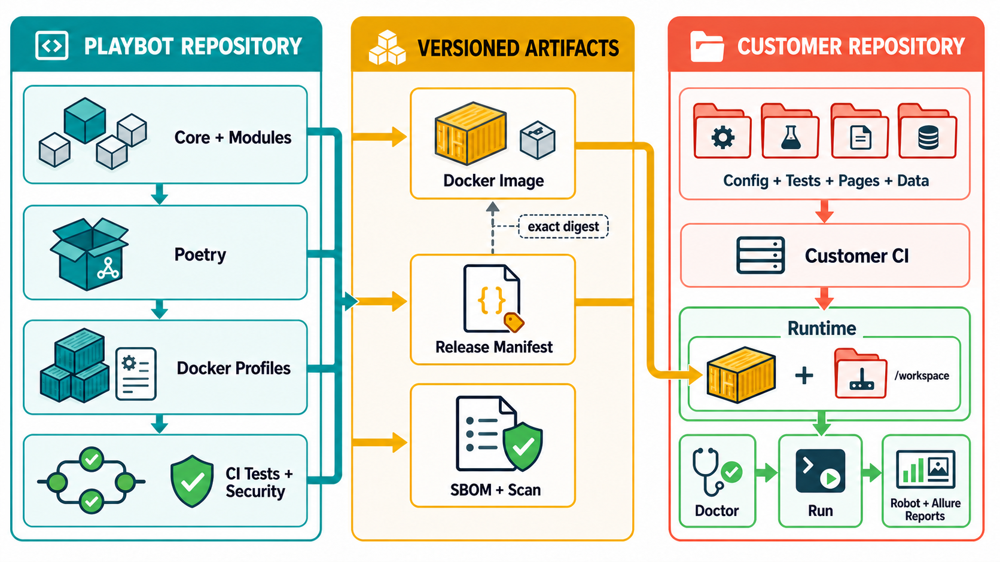
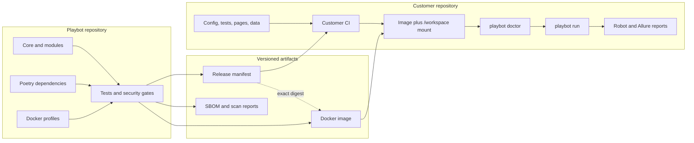

# Concepts And Reasons

Read this page when a Playbot term or ownership decision is unclear.

## System Overview



The Mermaid source below keeps the architecture editable and accessible:



## Terms

| Term | Meaning | Why it exists |
| --- | --- | --- |
| Core | Technology-neutral Playbot CLI and Robot API. | Every installation needs one stable base without optional tools. |
| Module | One optional capability such as Browser, Xray, or PDF text. | Dependencies and public APIs stay with their owner instead of growing Core. |
| Poetry extra | Selects a module's optional Python dependencies for local development. | Developers install only capabilities they work on. |
| Docker profile | A supported image containing selected modules and required system tools. | Customer CI gets a reproducible runtime, including browsers, Java, or fonts. |
| `module.toml` | Playbot-owned module contract: identity, dependencies, public entrypoint, config schema, and diagnostics. | Core can discover and validate modules without importing their technology code. |
| `playbot.toml` | Customer-owned project configuration and explicit module activation. | Every run is reviewable and reproducible. |
| Release manifest | Versioned OCI document connecting a Playbot version to image profiles and immutable digests. | Customer CI pulls exactly the artifact that passed central checks. |
| Image tag | Human-readable semantic version such as `0.3.0`. | Updates are understandable in pull requests. |
| Image digest | Immutable `sha256` identity of image content. | A tag cannot silently resolve to different bytes. |
| `playbot doctor` | Validates configuration, installed modules, dependencies, commands, tools, and required environment names. | Fail before a long Robot run starts. |
| `playbot run` | Runs Doctor, validates public Robot imports, then invokes Robot or Pabot. | Used modules must be active and installed. |

## Installed, Active, Used

The required direction is:

```text
used by a test -> active in customer playbot.toml -> installed in the image
```

- **Installed** comes from the Poetry installation or Docker profile.
- **Active** comes from the selected customer `playbot.toml`.
- **Used** comes from public module imports or commands in customer automation.

An installed but inactive module is allowed. A used but inactive module, or an
active module missing from the image, is an error.

## Poetry Versus Docker

Poetry resolves Python dependencies for Playbot development, testing, and image
construction. Docker is the customer runtime boundary and additionally owns
system dependencies. Customer CI normally pulls a released image and does not
run Poetry or rebuild Playbot.

## Ownership Decision

Playbot owns reusable framework behavior. A customer owns concrete business
automation, including tests, pages, locators, data, overrides, credentials, and
report publication. Mounting the customer checkout at `/workspace` combines
both areas at runtime without copying either repository into the other.

Next actions:

- Work on a customer repository: [Customer workflow](customer.md)
- Work on Playbot: [Development](development.md)
- Choose a capability: [Modules](modules.md)
