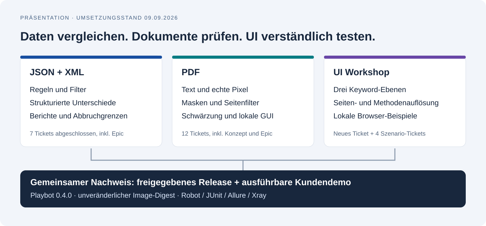
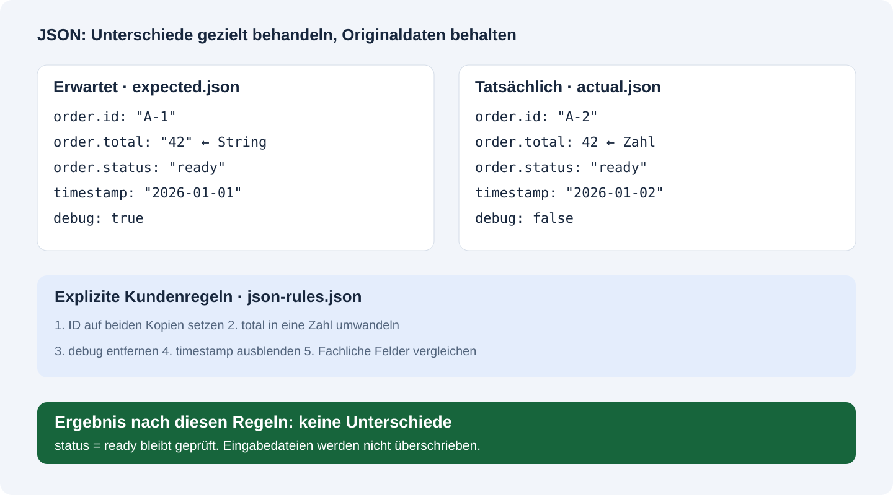
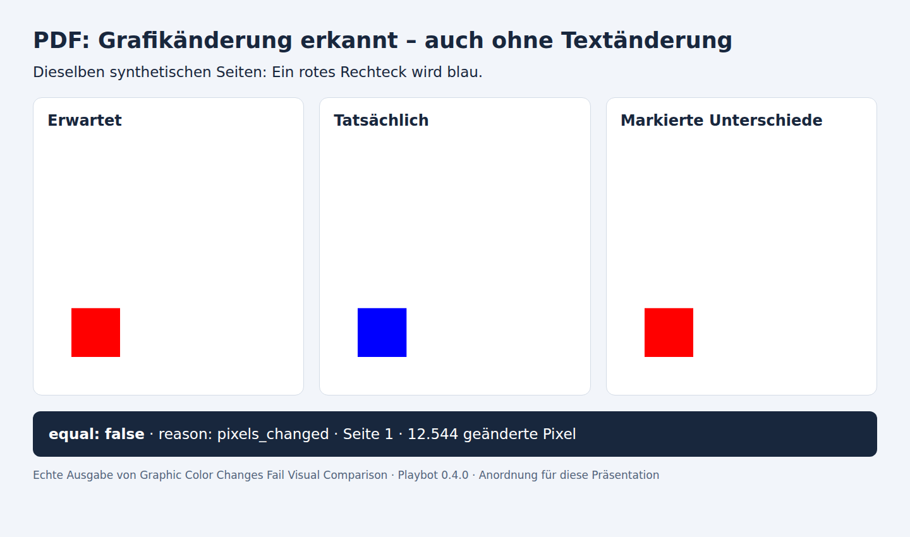
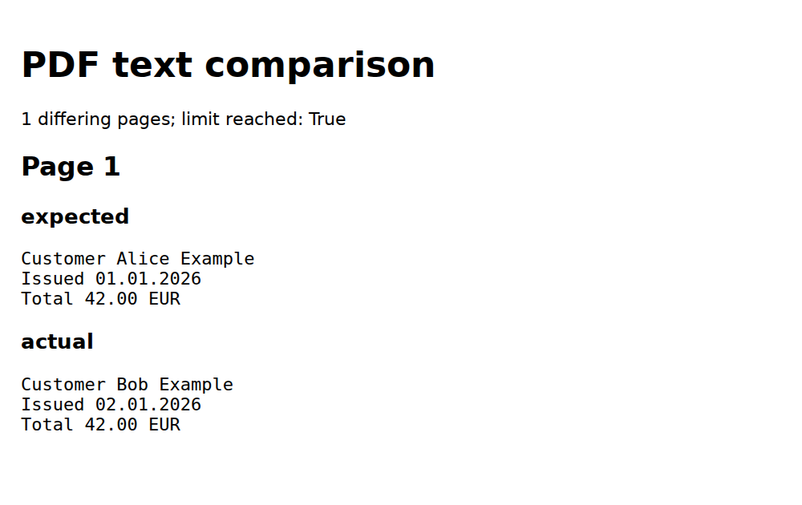
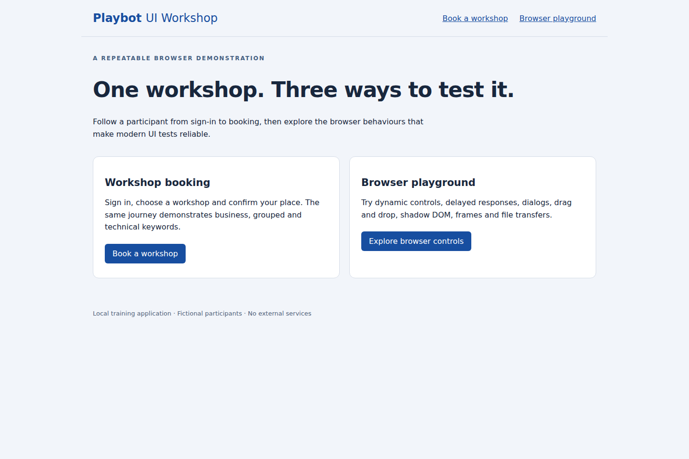
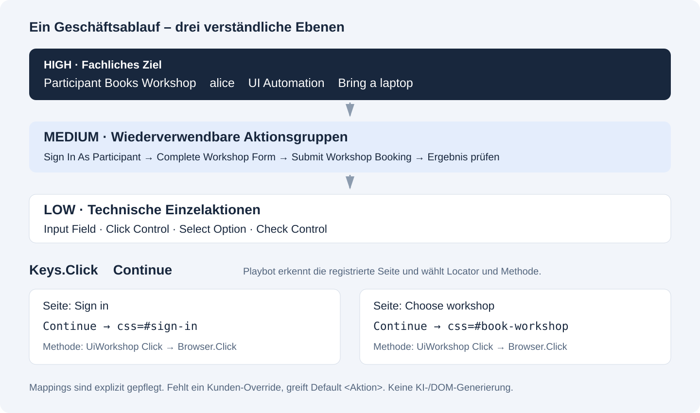
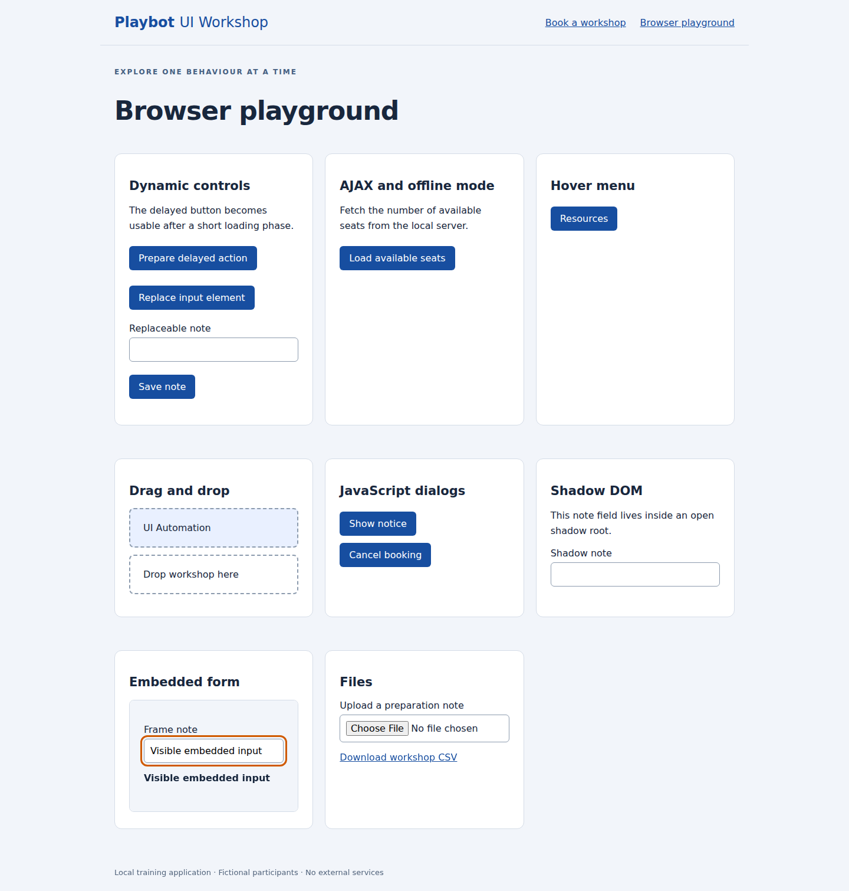

# Playbot – Entwickler-Einstieg und Release-Überblick

**Stand: 17. September 2026 · Aktuelles Release: 0.6.1**

[Öffentliches Entwicklerportal](https://test-automation-pts.github.io/playbot-portal/)
· [Allure](https://test-automation-pts.github.io/playbot-portal/allure/)
· [PDF-Dashboard](https://test-automation-pts.github.io/playbot-portal/pdf/)

Playbot ist eine modulare Robot-Framework-Laufzeit für Browser, APIs,
Datenbanken und Dokumentvergleiche. Der Einstieg folgt dem tatsächlichen
Entwicklerablauf: **Modul wählen → konfigurieren → Doctor → Tests → Berichte**.
Framework und Images werden zentral gepflegt; Tests, Testdaten, Seiten,
Locators und fachliche Keywords gehören in das Kundenprojekt.

## Aktuell: Was seit der ersten Präsentation hinzugekommen ist

| Release | Wichtigste Neuerung | Nutzen für Entwickler |
|---|---|---|
| [0.6.1](https://github.com/Test-Automation-PTS/playbot/releases/tag/v0.6.1) · 11.09.2026 | Reporting, Datenbanken, Modulübersicht | Evidenz und Archive wiederverwenden; Oracle/MySQL/PostgreSQL testen; öffentliche Imports finden |
| [0.5.0](https://github.com/Test-Automation-PTS/playbot/releases/tag/v0.5.0) · 10.09.2026 | API, WireMock und OpenAPI | HTTP-Abläufe isoliert und gegen Provider-Verträge prüfen |
| [0.4.0](https://github.com/Test-Automation-PTS/playbot/releases/tag/v0.4.0) · 07.09.2026 | JSON/XML und PDF finalisiert | Fachliche Unterschiede und visuelle Abweichungen nachvollziehbar machen |

### Reporting: Vom fehlgeschlagenen Test zum Beleg

Das neue Modul `reporting` erzeugt PDF-Evidenz und das PDF-Dashboard, bereitet
Allure-Historie, Executor, Umgebung und Fehlerkategorien vor und stellt statische
Archive zusammen. Das Dashboard verwendet den **abschließenden Robot-Status**;
ein fehlgeschlagener Teardown darf nicht als erfolgreicher Test erscheinen.
Beim Wechsel zu einem älteren PDF-Lauf bleibt die gesamte Zeitleiste sichtbar.

**Zeigen:** Im PDF-Dashboard einen Textvergleich und einen Pixelvergleich öffnen,
danach einen archivierten Lauf auswählen. In Allure die Suites, Behaviors und
Trends erklären. Fehlerkategorien klassifizieren Fehler; ein grüner Lauf zeigt
keine künstlich erzeugten Fehlerkategorien.

Die Reports stammen aus der öffentlichen Kundendemo. Ein Testlauf hat eine
eigene Laufnummer, Kundenrevision und Framework-Version. Diese Angaben sind
nicht mit dem Veröffentlichungsdatum einer Präsentation gleichzusetzen.

### Datenbanken und Modulübersicht

`database` stellt die bestehende DatabaseLibrary-API bereit: verbinden,
`Query`, `Execute SQL String`, Zeilenanzahl prüfen und Verbindungen schließen.
Die Images enthalten `oracledb` (Thin-Modus), `pymysql` und `psycopg2`.
Fachliches SQL, Zugänge und Testdaten bleiben beim Kunden. Playbot ergänzt keine
eigene SQL-Abstraktion oder implizite Retry-Logik.

```bash
playbot discover
playbot discover --json
playbot doctor --config config/playbot.toml
```

Discovery liest Manifeste und liefert öffentliche Imports, ohne optionale
Bibliotheken zu laden. Erst Doctor prüft die tatsächlich gewählte Laufzeit.
VS Code mit RobotCode bietet Keyword-Vervollständigung, Signaturen und
Navigation; Editor und CI verwenden dieselbe Playbot-Revision und Extras.

### API, WireMock und Provider-Verträge

`api` unterstützt HTTP-Sessions, JSON/XML/Formular-Payloads sowie Status-,
Header- und Laufzeitprüfungen. `api-mocks` betreibt isolierte WireMock-Prozesse
mit eigenen Ports, Request-Verifikation und automatischer Bereinigung.
Pabot-Worker teilen keinen Mock-Zustand. Beide Release-Profile enthalten die
benötigte Laufzeit. Geheimnisse werden über Umgebungsvariablennamen übergeben.

Gebündelte OpenAPI-3.0/3.1-JSON-Verträge prüfen echte Request-/Response-Paare.
Die 15 API-Kundenbeispiele zeigen Transport, Payload-Vergleich, Verträge,
Fehler, Verzögerungen und Isolation. SOAP-over-HTTP ist möglich; WSDL-Generierung,
XSD und Pact/Broker gehören nicht zu diesem Umfang.

### In ein Projekt einsteigen

1. [Kundenablauf](../docs/customer.md) lesen und ein Release mit Image-Digest pinnen.
2. [Module](../docs/modules.md) auswählen; `used → active → installed` beachten.
3. Öffentliche Ressourcen importieren und Doctor ausführen.
4. Tests ausführen und den passenden Report öffnen.
5. Für Framework-Beiträge [Entwicklung](../docs/development.md),
   [Architektur](../docs/concepts.md) und [Release-Ablauf](../docs/release.md) lesen.

**Ausblick, nicht implementiert:** Das universelle Vergleichsdashboard für
PDF/JSON/XML bleibt [#157](https://github.com/Test-Automation-PTS/playbot/issues/157).
Pact/Broker bleibt [#151](https://github.com/Test-Automation-PTS/playbot/issues/151).

## Vertiefung: bebilderte Demo zu 0.4.0

Der folgende Leitfaden bleibt als nachvollziehbarer historischer Demoablauf
erhalten. Seine Testzahlen, Laufzeiten und sein Image-Digest beziehen sich
ausdrücklich auf den Stand vom **9. September**, nicht auf das aktuelle Release.

**Präsentationsleitfaden · Stand: 9. September 2026 · Dauer: ca. 20 Minuten**

Zielgruppe: Fachbereich, Testautomatisierung und Entwicklung. Diese README in
der Markdown-Vorschau öffnen, beispielsweise in VS Code mit **Strg+Umschalt+V**.
Die Bilder liegen lokal in [images](images/) und funktionieren ohne Bilddienst.



## 1. Einstieg: Was wurde erreicht? · 2 Minuten

**Kernaussage für die Präsentation:**

> Playbot prüft strukturierte Daten, PDF-Dokumente und Browser-Oberflächen über
> nachvollziehbare Keywords. Die Funktionen sind in einer ausführbaren
> Kundendemo belegt und erzeugen auswertbare Berichte.

| Bereich | Vorhandene Basis | Finalisiert oder ergänzt |
|---|---|---|
| JSON/XML | JSON-Grundvergleich und interne Helfer | Öffentliche Regelverarbeitung, Filter, Änderungen, Berichte, echter Abbruch; neues XML-Modul |
| PDF | Textvergleich, Masken und lokale GUI | Echter Pixelvergleich, Seitenanzahl-Prüfung, einheitliche Masken, Berichte und Headless-Schwärzung |
| UI | Browser-Modul, Routing und HUK-Beispiele | Eigene lokale Website, drei Keyword-Ebenen, nachgewiesene Auflösung und gezielte Browser-Szenarien |

**Ergebnis:** 7 JSON/XML-Tickets, 12 PDF-Tickets und 5 UI-Tickets abgeschlossen.
Die **24 Tickets enthalten auch Epics und das PDF-Konzeptticket**; sie sind keine
Zählung von 24 unabhängigen neuen Funktionen. Kein Ticket wurde beim Audit
vorab lediglich als schon vollständig implementiert geschlossen.

Die Framework-Änderungen für JSON/XML und PDF sind in **Playbot 0.4.0**
veröffentlicht. Die spätere UI-Demo verwendet dessen vorhandene öffentliche API.
Die beiden Release-Profile heißen `all-modules` und `all-modules-no-browser`.
Die Kundendemo konsumiert einen festgelegten Image-Digest.

## 2. JSON und XML: Fachliche Unterschiede sichtbar machen · 4 Minuten



**Erklären:** Technische Unterschiede wie Zeitstempel oder unterschiedlich
typisierte Zahlen können bewusst behandelt werden. Welche Felder relevant sind,
legt eine explizite Kundenkonfiguration fest.

Umgesetzt sind:

- Verschachtelte Werte und Typunterschiede vergleichen; Unterschiede mit Pfad,
  erwartetem/tatsächlichem Wert und Typ in `diff_result.json` ausgeben.
- Werte setzen, Schlüssel entfernen und Typen umwandeln. Die Verarbeitung
  arbeitet auf Kopien und überschreibt die Original-Testdaten nicht.
- Whitelist und Blacklist in den öffentlichen Vergleich integrieren.
- Nach einer konfigurierten Anzahl Unterschiede tatsächlich abbrechen und
  `limit_reached` im Ergebnis dokumentieren; Prozessprotokolle schreiben.
- XML strukturiert vergleichen, Tags filtern und Werte ändern. Das XML-Modul
  nutzt den JSON-Berichtsmechanismus und ist explizit aktivierbar.

**Vorführen:** In der Kundendemo zuerst
[`expected.json`][json-expected], [`actual.json`][json-actual] und
[`json-rules.json`][json-rules] nebeneinander öffnen. Das Bild zeigt genau diese
Testdaten. Danach [die fünf Finalisierungsfälle][json-tests] zeigen:

1. `Configured Files Match Without Changing Test Data`: Unterschiede werden
   entsprechend den Regeln behandelt; die Quelldatei bleibt unverändert.
2. `Assertion Writes A Useful Failure Report`: `ready` gegenüber `failed`
   bleibt ein echter fachlicher Fehler. Der Bericht wird vor dem Fehlschlag geschrieben.
3. `Configured Discrepancy Limit Is Recorded`: Abbruchgrenze und Ergebnisstatus zeigen.

Auszug aus einem tatsächlich erzeugten Fehlerbericht:

```json
{
  "difference_count": 1,
  "values_changed": {
    "root['status']": {
      "actual_type": "str",
      "actual_value": "failed",
      "expected_type": "str",
      "expected_value": "ready"
    }
  }
}
```

**Sprechsatz:** „Wir ignorieren nicht pauschal Unterschiede, sondern beschreiben
die fachlich zulässigen Abweichungen. Der Bericht zeigt, was danach noch abweicht.“

Tickets: [#91][i91], [#92][i92], [#102][i102], [#103][i103], [#104][i104],
[#105][i105], Epic [#139][i139].

## 3. PDF: Inhalt, Darstellung und Masken · 5 Minuten

### Text und Pixel sind zwei verschiedene Prüfungen



Die drei Bilder stammen aus dem Test
[`Graphic Color Changes Fail Visual Comparison`][pdf-visual-tests]. Das
Rechteck ändert seine Farbe, obwohl kein Text geändert wurde. Der visuelle
Vergleich erkennt **12.544 geänderte Pixel** und meldet `pixels_changed`.
Damit wird genau eine Lücke des vorherigen Vergleichs geschlossen.



Der Textvergleich meldet extrahierbare Textunterschiede. Das Bild zeigt den
erzeugten HTML-Bericht, für die Präsentation mit größerer Schrift. Im Beispiel
wurde nach der ersten betroffenen Seite beendet: `limit reached: True`.

### Weitere umgesetzte Funktionen

| Funktion | Was zeigen? | Nachweis |
|---|---|---|
| Seitenanzahl | Auch eine zusätzliche **leere** Seite ist ein Unterschied | `Additional Blank Page…` in [Text][pdf-text-tests] und [visueller Suite][pdf-visual-tests] |
| Masken | Datum, Name oder definierte Bereiche ausdrücklich ausnehmen | `Configured…Masks…`, [masks.json][pdf-masks] |
| Seitenfilter und Grenzen | Bestimmte Seiten ein-/ausschließen, nach betroffenen Seiten abbrechen | [PDF-Text-Suite][pdf-text-tests] |
| Fehlerartefakte | JSON/HTML bzw. Erwartet-/Ist-/Differenz-PNGs vor dem Assertion-Fehler speichern | Beide Vergleichssuiten |
| Schwärzung | Neues PNG mit schwarzen Bereichen; neues gerastertes PDF ohne ursprüngliche Textebene | `Screenshot Regions Are Opaque Black`, `Redacted PDF Has No Original Text Layer` |
| Lokale Masken-GUI | Blöcke auswählen, Bereiche verschieben/vergrößern, manuell ergänzen und Prozentmasken exportieren | [GUI-Anleitung][pdf-docs] |

Masken verstehen Literaltexte, explizite Regexe und Tags wie `[DATE]` oder
`[ANY]`. Seitenbezogene Rechtecke können unter anderem als Prozentwerte
angegeben werden. Ungültige Masken führen zu verständlichen Fehlern.

**Vorführen:** Den Farbänderungsfall öffnen, dann die leere Zusatzseite und
abschließend den maskierten Vergleich. Bei erwarteten Abweichungen verwendet
die Demo `Run Keyword And Expect Error`: Der **Vergleich** soll fehlschlagen,
der korrekt prüfende **Demo-Test** soll bestehen.

**Sprechsatz:** „Textprüfung beantwortet, ob sich der Inhalt geändert hat.
Pixelprüfung erkennt zusätzlich Farben, Grafiken und Darstellung. Masken sind
bewusste Ausnahmen, die wir als Testdaten versionieren.“

**Grenzen für Rückfragen:** Keine OCR und keine automatische Erkennung
personenbezogener Daten. Schwärzung braucht definierte Masken. Das erzeugte
Raster-PDF bewahrt weder Suchtext noch Formulare oder digitale Signaturen.
`pdf-gui` ist ein lokales Werkzeug und gehört nicht zu den Release-Images.

## 4. UI: Die Framework-Funktionen unabhängig von HUK zeigen · 5 Minuten



Die neue Demo-Anwendung gehört zu `playbot-demo-customer`. Sie läuft lokal mit
der Python-Standardbibliothek, ohne HUK, CDN oder öffentliche Test-Website.
Fiktive Teilnehmer buchen einen Workshop: **Anmelden → Auswählen → Bestätigen**.
Die reguläre CI verwendet diese lokale Anwendung; HUK ist nur noch eine
ausdrücklich wählbare Legacy-Option.

### A. Derselbe Ablauf auf drei Keyword-Ebenen



| Ebene | Beispiel | Aussage |
|---|---|---|
| High / Business | `Participant Books Workshop` | Fachliches Ziel und erwartetes Ergebnis |
| Medium / gruppiert | `Sign In As Participant`, `Complete Workshop Form` | Wiederverwendbare Aktionsgruppen |
| Low / technisch | `Input Field`, `Click Control`, `Select Option` | Einzelne technische Browser-Aktion |

**Vorführen:** [01_keyword_levels.robot][ui-levels] öffnen. Alle drei Tests
buchen für `alice` denselben Workshop mit derselben Notiz. Im Robot-Log den
High-Aufruf aufklappen, bis die technischen Schritte sichtbar werden.

### B. Automatische Seiten-, Locator- und Methodenauswahl

Der Name `Continue` bleibt im Test gleich. Auf der Anmeldeseite wird daraus
`css=#sign-in`, auf der Workshop-Seite `css=#book-workshop`. Die importierte
Kundenmethode `UiWorkshop Click` erhält den aufgelösten Locator. Für `Fill Text`
gibt es keinen Kunden-Override; Playbot verwendet die Standardmethode.

**Wichtige Einordnung:** Automatisch ist die **Auswahl aus gepflegten Mappings**.
Die Demo behauptet keine KI-Erkennung oder automatische Erstellung beliebiger
Locators. Der Test [02_automatic_page_and_method_resolution.robot][ui-routing]
prüft die ausgewählte Seite, die konkreten Locators und das tatsächliche Ergebnis.

### C. Playwright-Funktionen an kleinen Beispielen



- **Auto-Waiting:** Ein Klick wartet auf einen zunächst deaktivierten Button.
- **Locator-Neuauflösung:** Nach DOM-Austausch wird das neue Eingabefeld angesprochen.
- **AJAX:** Antwort-Promise vor dem Klick registrieren, Antwort und UI prüfen.
- **Bedienung:** Hover, Drag-and-drop, Alert/Confirm, Shadow DOM, iframe, Upload/Download.
- **Isolation und Fehlerfälle:** Zwei Benutzerkontexte, Cookies/Session Storage,
  HTTP Auth, Redirects, begrenzter Timeout sowie Offline/Online-Wiederherstellung.
- **Pabot:** Dieselben vier realen Buchungen sequenziell und parallel ausführen;
  vier unterschiedliche und tatsächlich überlappende Anmeldungen nachweisen.

**Sprechsatz:** „Wir zeigen den praktischen Nutzen der Playwright-API. Viele
dieser Browser-Funktionen sind auch mit Selenium möglich; entscheidend ist,
wie verständlich und reproduzierbar sie im Framework nutzbar werden.“

Die [ausführliche UI-Methodologie][ui-docs] enthält die Zuordnung zu Tests und
offizielle Playwright-/Selenium-Quellen. Geprüft ist Chromium. Die Zeitmessung
ist weder ein Lasttest noch ein Geschwindigkeitsvergleich mit Selenium.
Im PR-CI-Lauf benötigten die vier Buchungen **9,170 s sequenziell und 10,805 s
parallel**; Start, Koordination, Traces und Reports sind enthalten. Ein
garantierter Geschwindigkeitsgewinn wird deshalb nicht behauptet.

## 5. Live-Demo vorbereiten

### Website unter Windows starten

`demo_site` liegt im **Demo-Repository**, nicht im Framework-Repository
`playbot`. Damit erklärt sich `ModuleNotFoundError: No module named 'demo_site'`,
wenn der Befehl im falschen Checkout oder vor dessen Aktualisierung läuft.

Falls `playbot-demo-customer` noch nicht lokal vorhanden ist, in PowerShell:

```powershell
Set-Location "$env:USERPROFILE\Projects"
git clone https://github.com/Test-Automation-PTS/playbot-demo-customer.git
```

Danach in das richtige Verzeichnis wechseln. Bei einem bereits vorhandenen
Checkout zunächst sicherstellen, dass er den gemergten Stand von `main` enthält.

```powershell
Set-Location "$env:USERPROFILE\Projects\playbot-demo-customer"
Test-Path .\demo_site\server.py
python -m demo_site.server
```

`Test-Path` muss **True** ausgeben. Die Website unter
**http://127.0.0.1:8765** öffnen. Anmeldung: `alice`, `bob`, `carol` oder `dan`,
jeweils mit dem öffentlichen Demo-Passwort `practice`. Mit **Strg+C** beenden.
Für die Website allein reichen Python 3.10+ und der aktuelle Demo-Checkout.

### Automatisierte Tests im freigegebenen Container

Voraussetzung: Docker läuft mit Linux-Containern; GHCR-Zugriff ist gemäß
[Kunden-README][demo-readme] eingerichtet. Alle folgenden Befehle werden im
Hauptverzeichnis von `playbot-demo-customer` ausgeführt.

```powershell
$PlaybotImage = "ghcr.io/test-automation-pts/playbot/all-modules@sha256:a62f249c046fe9a6f54995e29ee1ea3df6e4d148df7ded55cfc2d90dfc7a4edc"
docker pull $PlaybotImage
```

<details>
<summary>PowerShell-Befehle für JSON/XML, PDF und UI aufklappen</summary>

**JSON/XML:**

```powershell
docker run --rm --env HOME=/tmp --volume "${PWD}:/workspace" --workdir /workspace `
  $PlaybotImage run --config /workspace/config/compare-json.toml -- `
  --outputdir /workspace/reports/presentation-json `
  /workspace/robot/tests/modules/json /workspace/robot/tests/modules/xml
```

**PDF:**

```powershell
docker run --rm --env HOME=/tmp --volume "${PWD}:/workspace" --workdir /workspace `
  $PlaybotImage run --config /workspace/config/compare-pdf.toml -- `
  --outputdir /workspace/reports/presentation-pdf `
  /workspace/robot/tests/modules/pdf-text /workspace/robot/tests/modules/pdf-visual
```

**UI einschließlich Vier-Benutzer-Vergleich:**

```powershell
docker run --rm --shm-size=2g --env HOME=/tmp --env PLAYBOT_HEADLESS=true `
  --volume "${PWD}:/workspace" --workdir /workspace `
  --entrypoint /opt/playbot/venv/bin/python `
  $PlaybotImage -m demo_site.run_demo --benchmark
```

Die UI-Test-Fixture startet ihre eigenen lokalen Server. Für diese Tests muss
die manuell gestartete Website nicht laufen und kein Container-Port freigegeben
werden. Die Robot-Berichte liegen unter `reports/presentation-json`,
`reports/presentation-pdf` und `reports/ui-demo`; dort `log.html` oder
`report.html` öffnen. Der UI-Vergleich schreibt zusätzlich `measurements.md`
und `measurements.json`.

</details>

**Vor dem Termin:** Image laden und die drei Gruppen einmal ausführen.
Für die Vorführung die oben genannten Quelldateien und den
[veröffentlichten Allure-Report][allure] bereits öffnen. Falls kein Docker oder
Registry-Zugang verfügbar ist, die lokale Website, Bilder und geprüften Reports
zeigen; die fachliche Präsentation hängt nicht von einem neuen CI-Lauf ab.

## 6. Abschluss: Was ist nachweisbar fertig? · 2 Minuten

| Ergebnis | Nachweis |
|---|---|
| Release 0.4.0 veröffentlicht, zwei Profile | [Release und Artefakte][release] |
| JSON/XML implementiert, gemergt und in der Demo | [Framework-PR #145][pr-json], [Demo-PR #1][demo-pr-json] |
| PDF finalisiert, gemergt und in der Demo | [Framework-PR #146][pr-pdf], [Demo-PR #2][demo-pr-pdf] |
| UI-Methodologie und lokale Demo gemergt | [Framework-PR #148][pr-ui], [Demo-PR #3][demo-pr-ui] |
| Automatische Prüfung und Report-Veröffentlichung erfolgreich | [Demo-main-CI][ci-main], [Allure-Report][allure] |
| Weiterarbeit dokumentiert | [UI-Dokumentation][ui-docs], [Framework-Skill][core-skill], [Demo-Skill][demo-skill] |

Im geprüften vollständigen Kundenlauf: **1.071 Robot-Tests bestanden, keine
Fehler, ein bestehender Skip**. Darin enthalten sind **26 neue UI-Beispiele**
sowie **vier sequenzielle und vier parallele Browser-Buchungen**. Die 1.000
bestehenden Pabot-Templatefälle sind keine 1.000 realen Browser-Benutzer.
Die fünf HTTP-Fixture-Tests laufen zusätzlich. Historische Zahlen aus
verschiedenen PR-Läufen werden nicht zusammengerechnet.

**Schlussbotschaft für den Vortrag:**

> Die Funktionen sind über öffentliche Schnittstellen nutzbar, mit konkreten
> Testdaten demonstriert und durch Berichte nachvollziehbar. Weitere Szenarien
> können auf derselben dokumentierten Struktur aufbauen.

## Anhang: Vollständige Ticket-Zuordnung

Alle nachfolgenden Tickets sind abgeschlossen. Konzept- und Sammel-Tickets
werden ausdrücklich als solche aufgeführt.

| Bereich | Tickets | Ergebnis |
|---|---|---|
| JSON | [#92][i92] | Öffentlichen JSON-Vergleich vervollständigt |
| XML | [#91][i91] | XML-Modul und öffentliche Vergleichs-/Änderungsfunktionen ergänzt |
| JSON-Berichte | [#102][i102] | Differenzdatei, Typangaben und Prozessprotokoll |
| JSON-Änderungen | [#103][i103] | Set/Remove und Typumwandlung in öffentlicher API |
| JSON-Filter | [#104][i104] | Whitelist/Blacklist im Vergleich |
| JSON-Abbruch | [#105][i105] | Tatsächlicher früher Abbruch mit Grenzwertstatus |
| Vergleichs-Epic | [#139][i139] | Sammel-Ticket nach Umsetzung der Kinder geschlossen |
| PDF-Funktion | [#90][i90] | Öffentlichen PDF-Vergleich vervollständigt |
| PDF-Konzept | [#116][i116] | Bestehende Bibliothekswahl und technisches Konzept dokumentiert; kein weiterer Projekt-TODO offen |
| PDF-Keywords | [#117][i117] | Öffentliche Keywords, Parameter und Testdaten-Handhabung |
| PDF-Vergleich | [#118][i118] | Text, echte Pixel, Seitenabweichungen und Artefakte |
| PDF-Steuerung | [#119][i119] | Masken, Seitenfilter und Ergebnisdarstellung |
| PDF-GUI | [#130][i130] | Lokale Maskenbearbeitung und übertragbarer Prozentexport |
| PDF-Textmasken | [#132][i132], [#133][i133] | JSON-Regeln, Tags/Literale/Regex, Übersetzung und Seitenauswahl |
| PDF-Bildmasken | [#134][i134], [#135][i135] | Bereiche, Koordinaten und Prozentmasken konsistent verarbeiten |
| Schwärzung | [#136][i136] | Neue geschwärzte Screenshot-/Raster-PDF-Ausgaben |
| PDF-Epic | [#115][i115] | Sammel-Ticket nach Finalisierung geschlossen |
| UI-Methodologie | [#147][i147] | Neues Umsetzungsticket: lokale Website, drei Ebenen, Auflösung, Docs und Skills |
| UI-Formulare | [#59][i59] | Login, dynamische Inhalte, AJAX und Antwort-Synchronisation |
| UI-Controls | [#60][i60] | Hover, Drag-and-drop, Dialoge, Shadow DOM und iframe |
| UI-Parallelität | [#61][i61] | Vier reale Teilnehmer, parallele Logins und Laufzeitbelege |
| UI-Randfälle | [#63][i63] | Storage, HTTP Auth, Redirects, Timeout und Offline-Modus |

Die inhaltlich unbeschriebenen UI-Alttickets #42, #45 und #46 sowie das
übergreifende UI-Epic #142 bleiben offen. Sie werden nicht als fertig umgesetzt gezählt.

**Bildnachweise:** Überblick, JSON-Regeln und Keyword-Auflösung sind
Präsentationsdiagramme anhand der implementierten Funktionen. Die UI-Bilder
sind echte Screenshots der lokalen Anwendung. Der PDF-Pixelvergleich zeigt
unveränderte Erwartet-/Ist-/Differenz-PNGs aus dem bestandenen Demo-Fall in einer
Präsentationsanordnung; der Textbericht stammt aus `Difference Limit Stops
After One Affected Page`. Es wurden keine Kundendokumente für diese Bilder verwendet.

[json-expected]: https://github.com/Test-Automation-PTS/playbot-demo-customer/blob/main/robot/tests/data/compare/expected.json
[json-actual]: https://github.com/Test-Automation-PTS/playbot-demo-customer/blob/main/robot/tests/data/compare/actual.json
[json-rules]: https://github.com/Test-Automation-PTS/playbot-demo-customer/blob/main/robot/tests/data/compare/json-rules.json
[json-tests]: https://github.com/Test-Automation-PTS/playbot-demo-customer/blob/main/robot/tests/modules/json/json_finalisation.robot
[pdf-text-tests]: https://github.com/Test-Automation-PTS/playbot-demo-customer/blob/main/robot/tests/modules/pdf-text/pdf_finalisation.robot
[pdf-visual-tests]: https://github.com/Test-Automation-PTS/playbot-demo-customer/blob/main/robot/tests/modules/pdf-visual/pdf_finalisation.robot
[pdf-masks]: https://github.com/Test-Automation-PTS/playbot-demo-customer/blob/main/robot/tests/data/pdf-finalisation/masks.json
[pdf-docs]: https://github.com/Test-Automation-PTS/playbot/blob/main/docs/modules.md#local-mask-authoring
[ui-docs]: https://github.com/Test-Automation-PTS/playbot-demo-customer/blob/main/docs/ui-demonstration.md
[ui-levels]: https://github.com/Test-Automation-PTS/playbot-demo-customer/blob/main/robot/tests/demos/UiWorkshop/01_keyword_levels.robot
[ui-routing]: https://github.com/Test-Automation-PTS/playbot-demo-customer/blob/main/robot/tests/demos/UiWorkshop/02_automatic_page_and_method_resolution.robot
[demo-readme]: https://github.com/Test-Automation-PTS/playbot-demo-customer/blob/main/README.md
[allure]: https://test-automation-pts.github.io/playbot-reports/playbot-demo-customer/
[release]: https://github.com/Test-Automation-PTS/playbot/releases/tag/v0.4.0
[pr-json]: https://github.com/Test-Automation-PTS/playbot/pull/145
[demo-pr-json]: https://github.com/Test-Automation-PTS/playbot-demo-customer/pull/1
[pr-pdf]: https://github.com/Test-Automation-PTS/playbot/pull/146
[demo-pr-pdf]: https://github.com/Test-Automation-PTS/playbot-demo-customer/pull/2
[pr-ui]: https://github.com/Test-Automation-PTS/playbot/pull/148
[demo-pr-ui]: https://github.com/Test-Automation-PTS/playbot-demo-customer/pull/3
[ci-main]: https://github.com/Test-Automation-PTS/playbot-demo-customer/actions/runs/34340194122
[core-skill]: https://github.com/Test-Automation-PTS/playbot/blob/main/.codex/skills/playbot-ui-demonstration/SKILL.md
[demo-skill]: https://github.com/Test-Automation-PTS/playbot-demo-customer/blob/main/.codex/skills/ui-demo-authoring/SKILL.md
[i90]: https://github.com/Test-Automation-PTS/playbot/issues/90
[i91]: https://github.com/Test-Automation-PTS/playbot/issues/91
[i92]: https://github.com/Test-Automation-PTS/playbot/issues/92
[i102]: https://github.com/Test-Automation-PTS/playbot/issues/102
[i103]: https://github.com/Test-Automation-PTS/playbot/issues/103
[i104]: https://github.com/Test-Automation-PTS/playbot/issues/104
[i105]: https://github.com/Test-Automation-PTS/playbot/issues/105
[i115]: https://github.com/Test-Automation-PTS/playbot/issues/115
[i116]: https://github.com/Test-Automation-PTS/playbot/issues/116
[i117]: https://github.com/Test-Automation-PTS/playbot/issues/117
[i118]: https://github.com/Test-Automation-PTS/playbot/issues/118
[i119]: https://github.com/Test-Automation-PTS/playbot/issues/119
[i130]: https://github.com/Test-Automation-PTS/playbot/issues/130
[i132]: https://github.com/Test-Automation-PTS/playbot/issues/132
[i133]: https://github.com/Test-Automation-PTS/playbot/issues/133
[i134]: https://github.com/Test-Automation-PTS/playbot/issues/134
[i135]: https://github.com/Test-Automation-PTS/playbot/issues/135
[i136]: https://github.com/Test-Automation-PTS/playbot/issues/136
[i139]: https://github.com/Test-Automation-PTS/playbot/issues/139
[i147]: https://github.com/Test-Automation-PTS/playbot/issues/147
[i59]: https://github.com/Test-Automation-PTS/playbot/issues/59
[i60]: https://github.com/Test-Automation-PTS/playbot/issues/60
[i61]: https://github.com/Test-Automation-PTS/playbot/issues/61
[i63]: https://github.com/Test-Automation-PTS/playbot/issues/63

## Unreleased: Allure mit einem Publish-tests-Schritt veröffentlichen

Kundenprojekte können einen vorbereiteten `actions/publish-tests`-Schritt nutzen:
Report-Repository-URL, Environment und eng begrenztes Secret übergeben; Playbot
übernimmt History, Metadaten, Allure-Erzeugung, Index und Run-Archive. Es werden
keine Veröffentlichungs-Skripte ins Kundenprojekt kopiert.

Der Environment-Name steht im Report-Titel, in den Metadaten und im URL-Pfad.
Jede Umgebung erhält einen eigenen Verlauf und bis zu zwanzig vollständige
Run-Archive. Die GitHub-Zusammenfassung verlinkt den aktuellen und archivierten
Report. Ein fehlgeschlagener Test bleibt fehlgeschlagen, auch wenn sein Report
veröffentlicht wird.

[Einrichtung im Kundenprojekt](../docs/customer.md#unreleased-one-publish-tests-step-for-github-pages).
Diese Action ist noch kein Bestandteil eines neuen Runtime-Releases. Der Renderer
verwendet das unveränderte 0.6.1-Image; die neue Action wird über ihren Commit
referenziert. Report-Hosting, Sichtbarkeit und Berechtigungen bleiben beim Kunden.
